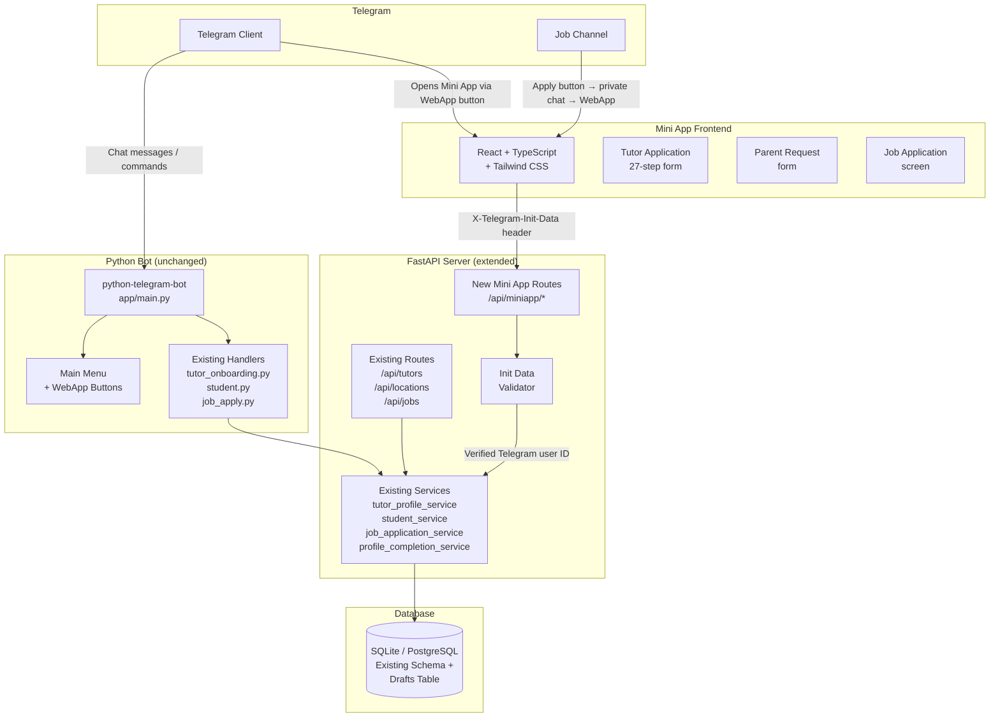

# Design Document — Tedor Tutors Mini App

## Overview

This design describes the migration of Tedor Tutors' Telegram bot form workflows to a Telegram Mini App and standalone web app. The existing Python bot, SQLite database, business logic, validation rules, matching engine, and job application workflows are preserved entirely. Only the user-facing form interface changes: instead of a message-by-message chat conversation, users complete graphical multi-step forms inside Telegram.

The deliverable has three parts:

1. **Backend extension** — new API endpoints added to the existing FastAPI server (`app/api/`) that serve the Mini App, backed by the same SQLAlchemy ORM and service functions the bot already uses.
2. **Telegram bot button** — a minimal change to the existing bot's main menu and job-post handler that adds WebApp buttons opening the Mini App.
3. **Mini App frontend** — a React + TypeScript + Tailwind CSS web application hosted at an HTTPS URL, configured in BotFather as the bot's Menu Button.

No existing code is deleted. All existing conversation handlers remain registered and functional.

---

## Architecture



### Key architectural decisions

- **No new database.** The Mini App reads from and writes to the same `tutor_index.db`. The only schema addition is a `drafts` table (see Data Models).
- **No new service layer.** `MINIAPP_ROUTES` calls the same service functions (`tutor_profile_service.create_ethiopian_tutor`, `student_service.create_student_request`, etc.) that the bot already calls. Business logic lives in exactly one place.
- **Auth is Init-Data only.** Every Mini App endpoint validates `X-Telegram-Init-Data` using HMAC-SHA256 with the bot token. There is no separate JWT or session cookie for the Telegram path. The web-fallback path uses a minimal token-based session that also resolves to a Telegram user ID.
- **Documents go through Telegram.** Uploaded files are forwarded to the Telegram storage channel via the existing `TelegramStorageService`, so no binary data is ever stored in the database and the existing admin review workflow is unchanged.

---

## Components and Interfaces

### 1. Init Data Validator (`app/api/miniapp/auth.py`)

Validates `window.Telegram.WebApp.initData` per the Telegram Bot API specification.

```
validate_init_data(init_data: str, bot_token: str) -> dict
```

- Splits `init_data` on `&`, extracts `hash=`, computes HMAC-SHA256 of the sorted remaining pairs using `HMAC("WebAppData", bot_token)` as the key.
- Returns the parsed user dict (including `id`) on success.
- Raises `AuthError` on mismatch or missing hash.

FastAPI dependency:

```
get_current_telegram_user(x_telegram_init_data: str = Header(...)) -> TelegramUser
```

### 2. Draft Service (`app/services/draft_service.py`)

Stores and retrieves partially-completed applications. Backed by the `drafts` table.

```
save_draft(session, telegram_user_id, draft_type, payload) -> Draft
get_draft(session, telegram_user_id, draft_type) -> Draft | None
delete_draft(session, telegram_user_id, draft_type) -> None
```

`draft_type` is one of `"tutor"` or `"parent"`. The `payload` column is JSON.

### 3. Mini App API Router (`app/api/routes/miniapp.py`)

All routes are prefixed `/api/miniapp` and protected by `get_current_telegram_user`.

| Method | Path | Description |
|--------|------|-------------|
| GET | `/tutor/profile` | Authenticated tutor's stored field values (public fields only) |
| GET | `/tutor/draft` | Incomplete tutor application draft, or 404 |
| POST | `/tutor/draft` | Save or update tutor application draft |
| POST | `/tutor/submit` | Submit tutor application (calls `tutor_profile_service.create_ethiopian_tutor`) |
| GET | `/parent/draft` | Incomplete parent request draft, or 404 |
| POST | `/parent/draft` | Save or update parent request draft |
| POST | `/parent/submit` | Submit parent request (calls `student_service.create_student_request`) |
| POST | `/documents/upload` | Upload one document file; forward to Telegram storage |
| GET | `/jobs/{ref}` | Job details + tutor match score for the authenticated tutor |
| POST | `/jobs/{ref}/confirm` | Confirm job application (calls `job_application_service.submit`) |

### 4. Bot Button Additions (`app/bot/handlers/start.py`)

The main menu gains two `InlineKeyboardButton` entries with `web_app=WebAppInfo(url=...)`. The URL is built from `settings.mini_app_url` plus a `#screen=tutor` or `#screen=parent` fragment.

The job-post handler gains a parallel WebApp button alongside the existing deep-link Apply button. The URL carries `#screen=job&ref={JOB_REFERENCE}`.

### 5. React Mini App (`mini-app/`)

Directory layout:

```
mini-app/
  src/
    api/           # typed fetch wrappers for /api/miniapp/*
    components/    # shared UI components (ProgressBar, FieldError, FileUpload, LocationSearch)
    forms/
      tutor/       # 27-step tutor application form
      parent/      # parent request form
      job/         # job application / recommendation screen
    hooks/         # useDraft, useAuth, useLocationSearch
    pages/         # Router entry points keyed on #screen
    store/         # Zustand slices for form state + draft sync
  public/
  index.html
  vite.config.ts
  tailwind.config.ts
  tsconfig.json
  package.json
```

State management: **Zustand** (lightweight, no boilerplate). Each form step is a Zustand slice; persistence to draft is triggered on every `nextStep()` call via a Zustand middleware.

Routing: hash-based (`#screen=tutor`, `#screen=parent`, `#screen=job&ref=JOB-000123`) so no server-side routing is needed for a static host.

---

## Data Models

### `drafts` table (new)

```sql
CREATE TABLE drafts (
    id              INTEGER PRIMARY KEY AUTOINCREMENT,
    telegram_user_id INTEGER NOT NULL,
    draft_type      VARCHAR(16) NOT NULL,   -- 'tutor' | 'parent'
    payload         TEXT NOT NULL,          -- JSON blob
    created_at      DATETIME NOT NULL,
    updated_at      DATETIME NOT NULL,
    UNIQUE (telegram_user_id, draft_type)
);
CREATE INDEX ix_drafts_telegram_user_id ON drafts (telegram_user_id);
```

Added as a `Draft` SQLAlchemy model in `app/models.py`. The `apply_schema_upgrades` function in `app/database.py` will create this table automatically via `Base.metadata.create_all`.

### No other schema changes

The existing `Tutor`, `TutorDocument`, `StudentRequest`, `Location`, `JobApplication`, and all relationship tables are unchanged.

---

## Correctness Properties

*A property is a characteristic or behavior that should hold true across all valid executions of a system — essentially, a formal statement about what the system should do. Properties serve as the bridge between human-readable specifications and machine-verifiable correctness guarantees.*

**Property Reflection:** After reviewing all prework entries, the following consolidations apply:
- Requirements 2.6, 12.3 are the same property (cross-user 403); kept as one.
- Requirements 9.1, 12.2 are the same property (private-field exclusion); kept as one.
- Requirements 5.2 and 9.7 both test document file validation; kept as separate properties because one tests the frontend validator and the other tests the API endpoint.
- Requirements 3.3 and the API submission path are separately tested: the frontend validation mirrors the server, and the server is the authoritative source.
- Requirements 5.5 and 5.4 are merged into one upload-round-trip property.

---

**Property 1: Init Data HMAC validation**

*For any* `initData` string signed with the real bot token, `validate_init_data(init_data, bot_token)` should return the correct user dict. *For any* string where the `hash` field was replaced with a different value, it should raise `AuthError`.

**Validates: Requirements 2.2, 2.3**

---

**Property 2: Init Data user ID extraction round-trip**

*For any* validly-constructed `initData` payload embedding a Telegram user ID, `validate_init_data(init_data, bot_token)["id"]` should equal the original user ID.

**Validates: Requirements 2.4**

---

**Property 3: Cross-user request isolation**

*For any* two distinct Telegram user IDs A and B, if a session authenticated as A calls any `/api/miniapp/*` endpoint referencing B's data (draft, profile, or document), the server should return HTTP 403.

**Validates: Requirements 2.6, 12.3**

---

**Property 4: Tutor profile response excludes private fields**

*For any* tutor record in the database, the response from `GET /api/miniapp/tutor/profile` should contain none of the following keys: `phone`, `email`, `telegram_user_id`, `telegram_storage_chat_id`, `telegram_storage_message_id`, `english_voice_file_id`, `english_voice_message_id`.

**Validates: Requirements 9.1, 12.2**

---

**Property 5: Draft save-then-load round trip**

*For any* partial tutor application payload, calling `POST /api/miniapp/tutor/draft` followed by `GET /api/miniapp/tutor/draft` should return a payload that contains all the same field values that were saved.

**Validates: Requirements 8.3, 9.3**

---

**Property 6: Parent draft round trip**

*For any* partial parent request payload, calling `POST /api/miniapp/parent/draft` followed by `GET /api/miniapp/parent/draft` should return a payload containing all the same field values.

**Validates: Requirements 9.5**

---

**Property 7: Submit clears the draft**

*For any* successfully submitted tutor application, a subsequent `GET /api/miniapp/tutor/draft` for the same user should return HTTP 404 (no resumable draft).

**Validates: Requirements 8.5**

---

**Property 8: Tutor application submission creates a matching database record**

*For any* valid tutor application payload submitted via `POST /api/miniapp/tutor/submit`, a `Tutor` row should exist in the database with field values equal to those in the payload (for all stored scalar fields).

**Validates: Requirements 9.4, 11.2**

---

**Property 9: Document upload stores only metadata**

*For any* successfully uploaded document file, the resulting `TutorDocument` row should have a non-null `telegram_file_id` and the database should contain no column storing the raw file bytes.

**Validates: Requirements 12.1**

---

**Property 10: Document upload rejects invalid file types**

*For any* file with an extension not in `{'.pdf', '.jpg', '.jpeg', '.png', '.webp'}`, the `POST /api/miniapp/documents/upload` endpoint should return HTTP 422.

**Validates: Requirements 5.2, 9.7**

---

**Property 11: Document upload authorization**

*For any* upload from authenticated user A that names a tutor record owned by user B, the endpoint should return HTTP 403.

**Validates: Requirements 12.5**

---

**Property 12: Job match score is bounded**

*For any* valid job reference and any tutor with a complete profile, the `score` field in the `GET /api/miniapp/jobs/{ref}` response should be a number in the range [0, 100].

**Validates: Requirements 9.8**

---

**Property 13: Mini App endpoint returns 401 without Init Data**

*For any* `/api/miniapp/*` endpoint, a request with no `X-Telegram-Init-Data` header or with a tampered one should return HTTP 401.

**Validates: Requirements 9.10, 2.3**

---

**Property 14: Tutor form field count matches the onboarding STEPS**

*For any* render of the tutor application form, the total number of distinct field keys rendered should equal the count of non-summary `Step` entries in `app/bot/handlers/tutor_onboarding.py`.

**Validates: Requirements 3.1**

---

**Property 15: Job URL construction embeds the reference**

*For any* valid job reference string, the URL constructed by the bot's job-post handler should contain that reference string as a substring.

**Validates: Requirements 1.3, 1.4**

---

**Property 16: Missing fields displayed match Profile Completion Service**

*For any* tutor record where `profile_completion_service.assess(tutor).needs_input` is true, the list of fields shown by the Mini App's incomplete-profile screen should be exactly `assess(tutor).outstanding`.

**Validates: Requirements 7.2**

---

**Property 17: Already-applied status displayed correctly**

*For any* job reference where the authenticated tutor has a terminal application status (SUBMITTED, SHORTLISTED, REJECTED, WITHDRAWN), loading the job screen should return a payload with that same status string rather than a recommendation payload.

**Validates: Requirements 7.5**

---

**Property 18: Currency selection matches country**

*For any* country string, the currency displayed in the parent request budget field should equal the result of `currency_for_country(country)`.

**Validates: Requirements 6.2**

---

## Error Handling

| Situation | Response |
|-----------|----------|
| Missing or invalid `X-Telegram-Init-Data` | HTTP 401, JSON `{"detail": "Authentication required"}` |
| Authenticated user requests another user's resource | HTTP 403, JSON `{"detail": "Forbidden"}` |
| Draft payload fails field-level validation | HTTP 422, JSON with per-field errors |
| Job reference is not found or not published | HTTP 404 from the jobs endpoint; Mini App displays "This job is no longer available" |
| File upload exceeds 20 MB | HTTP 413 from the upload endpoint; Mini App displays inline error |
| File type not allowed | HTTP 422; Mini App displays inline error |
| Telegram storage call fails during document upload | HTTP 502; Mini App shows retry option; draft is not corrupted |
| Network error from Mini App | Mini App shows "Something went wrong — tap to retry" without clearing form state |

---

## Testing Strategy

### Unit tests

- `test_miniapp_auth.py` — tests `validate_init_data` with known-good and tampered signatures, missing `hash`, and empty string.
- `test_miniapp_draft_service.py` — tests `save_draft`, `get_draft`, `delete_draft` against an in-memory SQLite session.
- `test_miniapp_routes.py` — tests each new route with the FastAPI `TestClient`, mocking `get_current_telegram_user` to inject specific user IDs.
- Frontend: Vitest + React Testing Library unit tests per component.

### Property-based tests

**Framework: [Hypothesis](https://hypothesis.readthedocs.io/)** (Python, already in `requirements.txt` and used by existing tests).

**Framework: [fast-check](https://github.com/dubzzz/fast-check)** (TypeScript, for the Mini App frontend).

Each property test runs a minimum of **100 iterations**.

Each property-based test is tagged with a comment in the format:
`# Feature: tedor-mini-app, Property N: <property text>`

For example:
```python
# Feature: tedor-mini-app, Property 5: Draft save-then-load round trip
@given(st.fixed_dictionaries({...}))
def test_draft_round_trip(payload):
    ...
```

**Backend PBT scope:**
- Properties 1–13 and 15–18 are implemented in Python using Hypothesis.
- Generators produce valid `initData` strings by constructing them with the correct HMAC signature.
- Generators for tutor payloads use the existing test `factories.py` and extend it with Hypothesis strategies.

**Frontend PBT scope:**
- Properties 14 and 18 are implemented in TypeScript using fast-check.
- The form field count test loads the actual STEPS definition (shared via a generated TypeScript constant) and counts rendered fields.
- The currency test generates arbitrary country strings and checks the displayed currency label.

**Integration checkpoint:**
- After all backend endpoints are implemented, run `pytest tedor-telegram/tests/` to confirm all existing tests still pass (Requirement 11.5).
